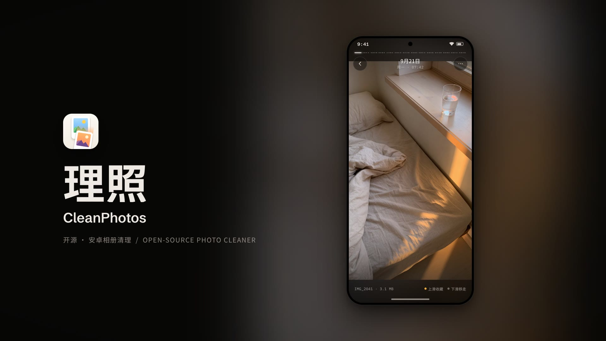

# CleanPhotos (理照)

English | [简体中文](README.zh-CN.md)

[](LICENSE)
[](https://github.com/winterszhangdong/cleanphotos/actions/workflows/test.yml)
[](https://github.com/winterszhangdong/cleanphotos/releases)


Swipe up to favorite, swipe down to trash, one photo at a time. CleanPhotos is an open-source Android app for cleaning up your photo library. It has no network access, no ads and no accounts.

> **The UI is available in Simplified Chinese and English and follows your system language (Chinese systems, including Traditional Chinese, show Chinese; all others show English). You can also switch it from the ⋯ menu on the Photos tab. Translations for other languages are welcome — add a `res/values-<lang>/strings.xml`.**



<p align="center">
  
  
  
  
  
  
</p>

## Features

- Photos grouped by day, with unseen markers, sorting (newest / oldest first) and an "unseen only" filter
- Full-screen review: swipe left/right to browse (across days), swipe up to favorite, swipe down to move to the in-app trash
- Undo after every action
- A day summary page between days once a day of 6+ photos has been fully reviewed
- Favorites tab, pinch and double-tap zoom, predictive back on Android 14+
- In-app trash: restore photos, or empty it to permanently delete them from the system gallery (with a confirmation and the system's delete prompt)
- Dark "darkroom" UI built with Jetpack Compose
- Simplified Chinese and English UI, following the system language, switchable in the app

## Download

Requires Android 8.0 or later. Download the latest APK from [GitHub Releases](https://github.com/winterszhangdong/cleanphotos/releases/latest).

[](https://github.com/winterszhangdong/cleanphotos/releases/latest)

## Permissions and privacy

The app only asks to read photos and videos (`READ_MEDIA_IMAGES` and `READ_MEDIA_VIDEO` on Android 13+, plus `READ_MEDIA_VISUAL_USER_SELECTED` for partial access on Android 14+, and `READ_EXTERNAL_STORAGE` on Android 12L and below). On Android 8–10 it also asks for `WRITE_EXTERNAL_STORAGE` when you first empty the trash, because those versions need it to delete photos; Android 11+ uses the system delete confirmation instead. The manifest declares no `INTERNET` permission and the app contains no analytics. Favorites, trash and seen state are stored on the device in DataStore; photo files stay in the system gallery until you empty the trash. See [PRIVACY.md](PRIVACY.md).

## Build from source

Requirements:

- JDK 17 or later (CI uses Temurin 21)
- Android SDK with platform 36
- Gradle 9.4.1 is downloaded by the wrapper (`./gradlew`)

```bash
make build         # assemble debug APK (./gradlew assembleDebug)
make test          # unit tests (./gradlew testDebugUnitTest)
make lint          # Android Lint (./gradlew lint)
make release       # assemble release APK
make install       # install debug APK on a connected device
make android-test  # instrumentation tests (device or emulator required)
make help          # list all targets
```

Tech stack: Kotlin, Jetpack Compose, MVVM + UseCase, Coroutines/Flow, Hilt, Navigation Compose, Coil, MediaStore, DataStore, Haze. Architecture: `Compose → ViewModel → UseCase → Repository → MediaStore / DataStore` (see `docs/architecture.md`). Design and interaction specs live in `docs/` (in Chinese).

## Contributing

See [CONTRIBUTING.md](CONTRIBUTING.md) and the [Code of Conduct](CODE_OF_CONDUCT.md). Report security issues as described in [SECURITY.md](SECURITY.md). Changes are listed in [CHANGELOG.md](CHANGELOG.md).

## Verify the APK

Release APKs are built and signed by GitHub Actions from `v*` tags. Signing certificate SHA-256:

```text
78:A6:BD:4F:43:2A:F2:7A:D7:57:3B:95:1F:89:8D:7D:33:BC:7D:74:7C:2A:42:BF:EE:B2:93:04:D5:8F:49:80
```

Check it with `apksigner verify --print-certs cleanphotos.apk`.

## License

Apache License 2.0, see [LICENSE](LICENSE). Third-party fonts, images and dependencies are listed in [NOTICE](NOTICE).

## Community

Thanks to the [LINUX DO](https://linux.do) community.
