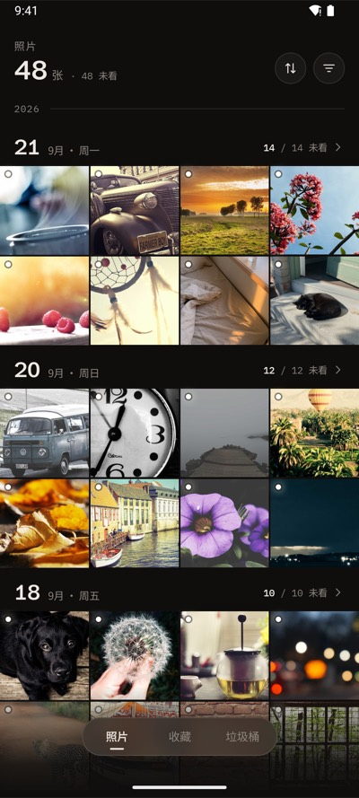
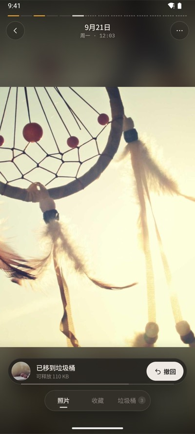
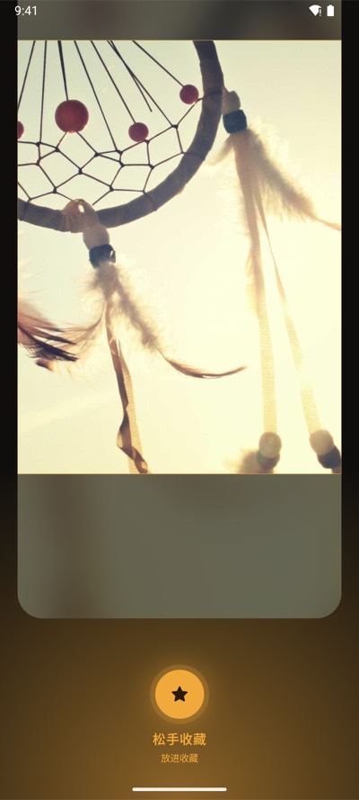
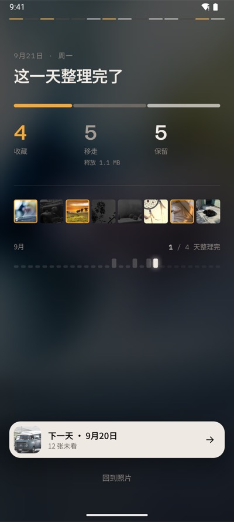
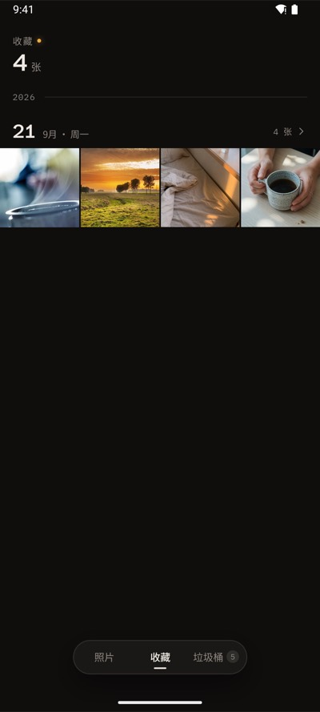
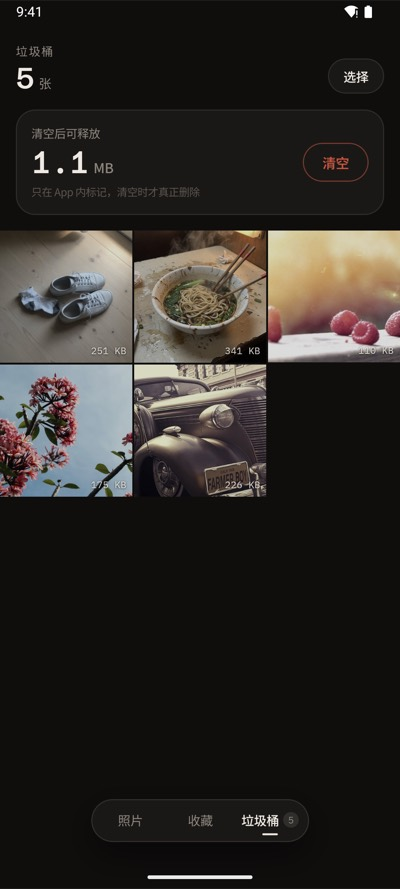

# 理照 CleanPhotos

[English](README.md) | 简体中文

上滑收藏，下滑移走，一次只看一张。开源的安卓相册清理 App。不联网、无广告、无账号。

[](https://cleanphotos.winters.click/)

<p align="center">
  
  
  
  
  
  
</p>

Apache License 2.0，见 [LICENSE](LICENSE)。第三方字体、照片和依赖见 [NOTICE](NOTICE)。报告问题和提交改动见 [CONTRIBUTING.md](CONTRIBUTING.md)。

## 功能

- 首页按日期分组展示照片
- 清理页左右滑动浏览，上滑收藏，下滑移入 App 内垃圾桶
- 操作后可撤回
- 垃圾桶里的照片可以恢复；清空垃圾桶才会永久删除系统里的照片，并且要再确认一次
- 界面支持简体中文和英文，默认跟随系统语言（中文系统含繁体显示中文，其他语言显示英文），也可在照片页「⋯」菜单里切换；欢迎贡献其他语言的翻译（新增 `res/values-<语言>/strings.xml` 即可）

## 安装

需要 Android 8.0 或更高版本。从 [GitHub Releases](https://github.com/winterszhangdong/cleanphotos/releases/latest) 下载最新 APK。

[](https://github.com/winterszhangdong/cleanphotos/releases/latest)

## 权限

应用只申请读取照片和视频。Android 8–10 上第一次清空垃圾桶时会额外申请 `WRITE_EXTERNAL_STORAGE`，这些版本删除照片需要它；Android 11+ 改用系统删除确认弹窗。清单未声明 `INTERNET`。收藏、垃圾桶和整理记录写在本机 DataStore，照片文件留在系统相册里，直到清空垃圾桶。详见 [隐私说明](PRIVACY.md)。

## 技术栈

- Kotlin + Jetpack Compose
- MVVM + UseCase
- Coroutines / Flow
- Coil（图片加载）
- MediaStore（系统相册访问）
- DataStore（本地状态持久化）
- Hilt（依赖注入）
- Navigation Compose

## 从源码构建

### 环境要求

- Android Studio 当前稳定版
- JDK 17 或更高（CI 用 Temurin 21）
- Gradle 9.4.1（通过 `./gradlew` 自动下载）
- Android SDK 36
- 连接的 Android 设备或模拟器（运行 instrumentation 测试时需要）

### 常用命令

项目提供了 Makefile 封装常用操作，直接 `make` 查看所有可用命令：

```bash
make help          # 显示所有命令
make build         # 构建 debug APK
make release       # 构建 release APK
make test          # 运行单元测试
make android-test  # 运行 instrumentation 测试
make lint          # 运行 Lint 检查
make install       # 安装到设备
make clean         # 清理构建产物
make deps          # 查看依赖树
make logcat        # 查看应用日志
make clear-data    # 清除应用数据
```

也可以直接使用 Gradle：

```bash
./gradlew assembleDebug
./gradlew testDebugUnitTest
./gradlew lint
```

## 项目文档

```
docs/product.md          产品目标和页面定义
docs/ui-design.md        视觉、动效和逐屏 UI 规格
docs/architecture.md     工程架构
docs/interaction.md      具体交互逻辑
docs/data-model.md       数据结构和接口
docs/test-plan.md        测试设计说明
```

## 架构

```
Compose → ViewModel → UseCase → Repository → MediaStore / DataStore
```

详见 `docs/architecture.md`。

## 校验 APK

发布版 APK 由 GitHub Actions 在打 `v*` 标签时构建并签名。证书 SHA-256：

```text
78:A6:BD:4F:43:2A:F2:7A:D7:57:3B:95:1F:89:8D:7D:33:BC:7D:74:7C:2A:42:BF:EE:B2:93:04:D5:8F:49:80
```

可以用 `apksigner verify --print-certs cleanphotos.apk` 核对。

## 社区

感谢 [LINUX DO](https://linux.do) 社区。
